 

## 📖 PROLOGUE

> B.Tech graduate in **CSE (AI & ML)** (Class of 2026), **Dronacharya College of Engineering, Gurugram**.
> I build full-stack products, ML systems and automation that people actually use, from React dashboards to local-model pipelines and desktop apps.

- 🧠 Currently building retrieval (RAG) pipelines for an AI IP/patent assistant
- ⚙️ Love automation: if I do something twice, I script it
- 🧩 Practising DSA on LeetCode (**256+ solved**)
- 🎯 Actively looking for full-stack / SDE roles — available immediately, open to relocation

## ⚔️ POWER LEVELS (Tech Stack)

## 🗺️ QUEST LOG (Experience)

## 🔥 SPECIAL MOVES (Projects)

| Panel | Project | What it does | Stack |
|:--:|:--|:--|:--|
| 🎬 | **Kokoro Studio** | Content-automation studio powered by local models. Its pilot channel grew to **150 subscribers in 5 weeks** from organic search. | React, Node.js, local models |
| 🤖 | **Task-Logger Automation** | AutoHotkey script that screenshots at random intervals, sends them to Drive, and uses a low-cost AI model to detect the current task and log it to Google Sheets. | AutoHotkey, Google Drive/Sheets, AI API |
| 🧾 | **Auto-Format Print Module** | Reusable templates that turn any logistics stage into a one-click, print-ready PDF bill. Used across **28 workflow stages**. | MERN |
| 🎙️ | **Voice-Controlled Automation** | Voice-driven Python assistant with **50+ OS-level operations**. Won the College Hackathon 2023. | Python |

## 🏆 HALL OF FAME

| | Achievement |
|:--:|:--|
| 🥇 | **Winner**, College Hackathon 2023 |
| 🥈 | **2nd place**, IIT Jammu Bootcamp (real-time employee performance tracking) |
| 🤖 | **Semi-finalist**, e-Yantra, IIT Bombay (autonomous bot navigation using Dijkstra's algorithm) |
| 📈 | **All India Rank 15** (Slot 3), NCAT 2025 |

## 📊 BATTLE STATS

 

 

 

## 📬 NEXT CHAPTER

**Got an idea, a bug, or a wild project? Let's put it on the next page.**

**— TO BE CONTINUED —**

