 

## 📖 PROLOGUE

> B.Tech graduate in **CSE (AI & ML)** (Class of 2026), **Dronacharya College of Engineering, Gurugram**.
> I build full-stack products, ML systems and automation that people actually use, from React dashboards to local-model pipelines and desktop apps.

- 🛡️ Building [**TrustRAG-Agent**](https://ankit500ak.github.io/manga-portfolio/#research) — my multi-agent RAG framework that verifies before it answers: fabricated answers on unanswerable questions fall from **100%** (no verification) → **74.0%** → **58.7% held-out** across two gates (SQuAD v2)
- 📄 6 research papers — none peer-reviewed yet; *Who Verifies the Verifier?* is a **live preprint on Preprints.org** with a DOI
- ⚙️ Love automation: if I do something twice, I script it
- 🧩 Practising DSA on LeetCode (**256+ solved**)
- 🎯 Actively looking for full-stack / SDE roles — available immediately, open to relocation
- 📥 [**Download my resume (PDF)**](https://ankit500ak.github.io/manga-portfolio/Ankit_Pal_Resume.pdf)

 

## ⚔️ POWER LEVELS (Tech Stack)

## 🗺️ QUEST LOG (Experience)

## 🔥 SPECIAL MOVES (Projects)

| Panel | Project | What it does | Stack |
|:--:|:--|:--|:--|
| 🛡️ | [**TrustRAG-Agent**](https://ankit500ak.github.io/manga-portfolio/#research) | Multi-agent RAG that verifies before it answers — planner, hybrid retriever, verifier and cited generator with an audit log. Fabricated answers on unanswerable questions cut **100% → 58.7%** (held-out) across two gates. | Python, Multi-Agent RAG |
| 🎬 | **Kokoro Studio** | AI story-to-video studio — **Gemini** generates the stories, locally-run **Kokoro TTS** voices them. Its pilot channel grew to **150 subscribers in 5 weeks** from organic search. | React, Node.js, Gemini API, Kokoro TTS |
| 🤖 | **Task-Logger Automation** | AutoHotkey script that screenshots at random intervals, sends them to Drive, and uses a low-cost AI model to detect the current task and log it to Google Sheets. | AutoHotkey, Google Drive/Sheets, AI API |
| 🧾 | **Auto-Format Print Module** | Reusable templates that turn any logistics stage into a one-click, print-ready PDF bill. Used across **28 workflow stages**. | MERN |
| 🎙️ | **Voice-Controlled Automation** | Voice-driven Python assistant with **50+ OS-level operations**. Won the College Hackathon 2023. | Python |

## 🏆 HALL OF FAME

| | Achievement |
|:--:|:--|
| 🥇 | **College Dev Champion ×3** — won the college development competition three consecutive years, incl. the College Hackathon 2023 (Dronacharya) |
| 🥈 | **2nd Runner-Up**, IIT Jammu Bootcamp (real-time employee performance tracking) |
| 🤖 | **Semi-finalist**, e-Yantra, IIT Bombay (autonomous bot navigation using Dijkstra's algorithm) |
| 📈 | **All India Rank 15** (Slot 3), NCAT 2025 — a national-level aptitude test |

## 📚 RESEARCH & IP

- 📄 **Who Verifies the Verifier?** — reliability, bias and trust in LLM-as-a-Judge evaluation. Live preprint on Preprints.org (not peer-reviewed) · [DOI 10.20944/preprints202611.2489.v1](https://doi.org/10.20944/preprints202611.2489.v1)
- 📄 **Agentic Retrieval-Augmented Generation** — IEEE-format preprint (not peer-reviewed); the paper behind TrustRAG-Agent
- 📄 Four more research manuscripts (2026, unpublished): *Model Collapse*, *Beyond Silicon*, *Why Agents Fail*, *Beyond the Prompt*
- ©️ **5 registered copyrights** (Copyright Office, India) — 4 as author, 1 co-owned: Project Zero · Code Weave · Paper Plus · ShadowMesh · Athenaeum
- 🔀 Open source: [pycubrid PR #1300](https://github.com/cubrid-lab/pycubrid/pull/1300) **merged** · [cubrid-mcp-server PR #590](https://github.com/cubrid-lab/cubrid-mcp-server/pull/590) in review

## 📊 BATTLE STATS

 

 

 

## 📬 NEXT CHAPTER

**Got an idea, a bug, or a wild project? Let's put it on the next page.**

**— TO BE CONTINUED —**

