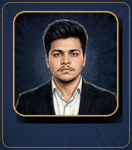

 

 

### ⚡ VOL. 01 — THE BUILDER ARC ⚡

> *Every panel on this page is something I built, wrote or registered — and most of it you can check. This is the story so far.*

## 📖 CHAPTER 01 — THE HERO

| Stat | Character File |
|:--|:--|
| **Name** | Ankit Pal |
| **Class** | Full-Stack Developer · Applied AI (RAG, verification) |
| **Guild** | B.Tech, CSE (AI & ML) — Dronacharya College of Engineering, Gurugram · Class of 2026 · CGPA 8.5 |
| **Base** | Gurugram, India — open to relocation |
| **Special Stat** | LeetCode **256+** problems solved |
| **Status** | 🟢 **Available immediately** — actively seeking full-stack / SDE roles |

> *Fighting style: build it, verify it, ship it. Anything I do twice gets automated.*

- 🛡️ Latest build: [**TrustRAG-Agent**](https://ankit500ak.github.io/manga-portfolio/#research) — a multi-agent RAG framework that refuses to answer when the evidence is weak
- 📥 [**Download my resume (PDF)**](https://ankit500ak.github.io/manga-portfolio/Ankit_Pal_Resume.pdf)

## ⚔️ CHAPTER 02 — POWER LEVELS

Text version

React · Next.js · TypeScript · Node · Django · FastAPI · Python · RAG · SQL · Docker · AWS

## 🗺️ CHAPTER 03 — QUEST LOG

Text version

- **Young Thames, Noida** — Executive Assistant (Web); led a team of 8 interns · Sep–Nov 2026
- **Logiedge, Gurugram** — Full-Stack Developer (MERN) · Feb–May 2026
- **Ambrosia Botanicals, Gurugram** — Full-Stack Developer · Oct–Dec 2025
- **IISPPER, Remote** — Full-Stack Developer Intern · Mar–Oct 2025

## 🔥 CHAPTER 04 — SPECIAL MOVES

| Panel | Project | What it does | Stack |
|:--:|:--|:--|:--|
| 🛡️ | [**TrustRAG-Agent**](https://ankit500ak.github.io/manga-portfolio/#research) | Multi-agent RAG that verifies before it answers — planner, hybrid retriever, verifier and cited generator with an audit log. Fabricated answers on unanswerable questions cut **100% → 74.0% → 58.7% held-out** across two verification gates (SQuAD v2). | Python, Multi-Agent RAG |
| 🎬 | **Kokoro Studio** | AI story-to-video studio — **Gemini** generates the stories, locally-run **Kokoro TTS** voices them. Its pilot channel reached **150 subscribers in 5 weeks**, all organic. | React, Node.js, Gemini API, Kokoro TTS |
| 🤖 | **Task-Logger Automation** | Personal AutoHotkey tool — screenshots my own screen at random intervals and logs the detected task to Google Sheets using a low-cost AI model. | AutoHotkey, Google Sheets, AI API |
| 🧾 | **Auto-Format Print Module** | Reusable templates that turn any logistics stage into a one-click, print-ready PDF bill. Used across **28 workflow stages** at Logiedge. | MERN |
| 🎙️ | **Voice-Controlled Automation** | Voice-driven Python assistant with **50+ OS-level operations**. Won the College Hackathon 2023. | Python |

## 🏆 CHAPTER 05 — HALL OF FAME

| | Achievement |
|:--:|:--|
| 🥇 | **College Dev Champion ×3** — won the college development competition three consecutive years, incl. the College Hackathon 2023 (Dronacharya) |
| 🥈 | **2nd Runner-Up**, IIT Jammu Bootcamp (real-time employee performance tracking) |
| 🤖 | **Semi-finalist**, e-Yantra Robotics Competition, IIT Bombay — autonomous bot navigation with Dijkstra's algorithm |
| 📈 | **All India Rank 15** (Slot 3), NCAT 2025 |

## 📚 CHAPTER 06 — SCROLLS & RELICS

> *The research arc. One preprint is public with a DOI; the rest are manuscripts, and each is labelled as such.*

- 📄 **Who Verifies the Verifier?** — reliability, bias and trust in LLM-as-a-Judge evaluation. Live preprint on Preprints.org (not peer-reviewed) · [DOI 10.20944/preprints202611.2489.v1](https://doi.org/10.20944/preprints202611.2489.v1)
- 📄 **Agentic Retrieval-Augmented Generation** — preprint in IEEE conference format (not peer-reviewed, not published by IEEE); the basis of TrustRAG-Agent
- 📄 Four more research manuscripts (2026, unpublished): *Model Collapse*, *Beyond Silicon*, *Why Agents Fail*, *Beyond the Prompt*
- ©️ **5 software copyrights registered** (Copyright Office, India — software works, not patents): 4 as author (Project Zero, Code Weave, Paper Plus, ShadowMesh) and 1 co-owned (Athenaeum)
- 🔀 Open source: [hachi PR #167](https://github.com/OpenGigantic/hachi/pull/167) **merged (27 Nov 2026)** — secret scan over the tracked file tree · [pycubrid PR #1300](https://github.com/cubrid-lab/pycubrid/pull/1300) **merged** · [cubrid-mcp-server PR #590](https://github.com/cubrid-lab/cubrid-mcp-server/pull/590) in review

## 📊 BATTLE STATS

 

 

 

## 📬 FINAL CHAPTER — NEXT PAGE

**Got an idea, a bug, or a wild project? Let's put it on the next page.**

**— TO BE CONTINUED —**

